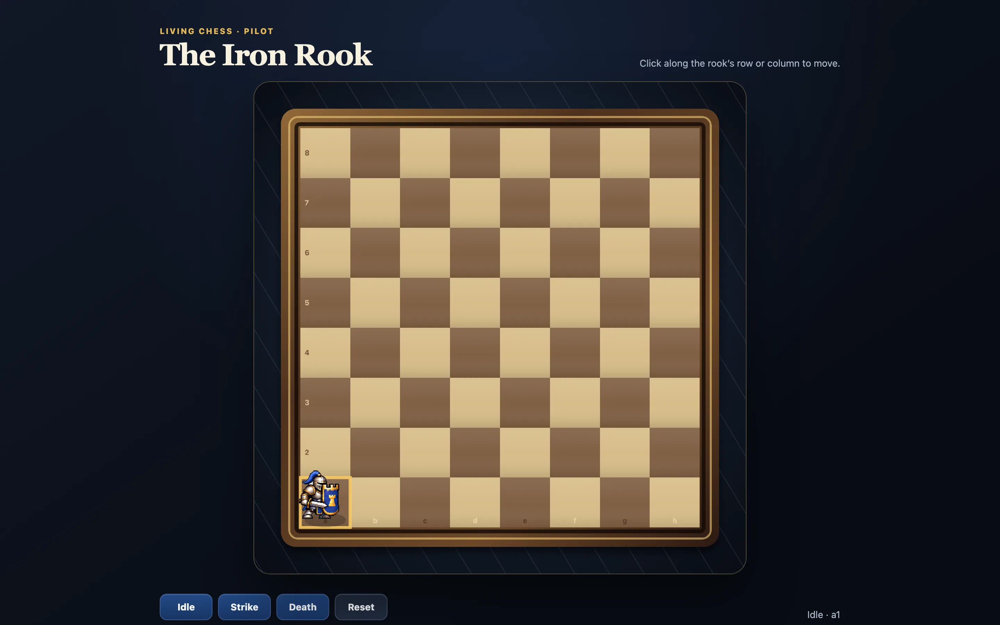

# Game-Making-Playground



**Problem.** Whether an upright, side-view animated character reads clearly on a fixed, near-top-down chessboard is an open question.

**Idea.** A 2.5D scene: the camera is fixed with no rotation, and the character stays upright and mirrors for leftward moves. One piece and a handful of animation states are enough to test it.

**Built.** A pilot only: one animated pixel-art rook (idle, move, strike, death) with legal horizontal and vertical moves, written in dependency-free JavaScript on Canvas with model and browser tests. 4 commits on 4 days, Sep 10 to Oct 20, 2026.

**Decision.** The pilot keeps the camera fixed and the sprites upright instead of building a 3D board, so it tests one thing: whether the character reads. The separate premium 3D chess concept is out of scope.

## Living Chess rook pilot

A fixed-camera 2.5D browser prototype with an animated pixel-art rook, legal
horizontal and vertical movement, and Idle, Strike, Death, and Reset controls.
Press F for fullscreen.

Run it from the repository root:

```bash
python3 -m http.server 4173 --bind 127.0.0.1
```

Then open <http://127.0.0.1:4173/web-demo/>.

Run the automated tests with:

```bash
cd web-demo
npm test
```

`web-demo/package.json` declares no dependencies, but `tests/browser-smoke.test.mjs`
imports `playwright`, so that package (with a Chromium build) must be installed
for the browser test to run.

Design notes are in `docs/superpowers/specs/` and `docs/superpowers/plans/`.
