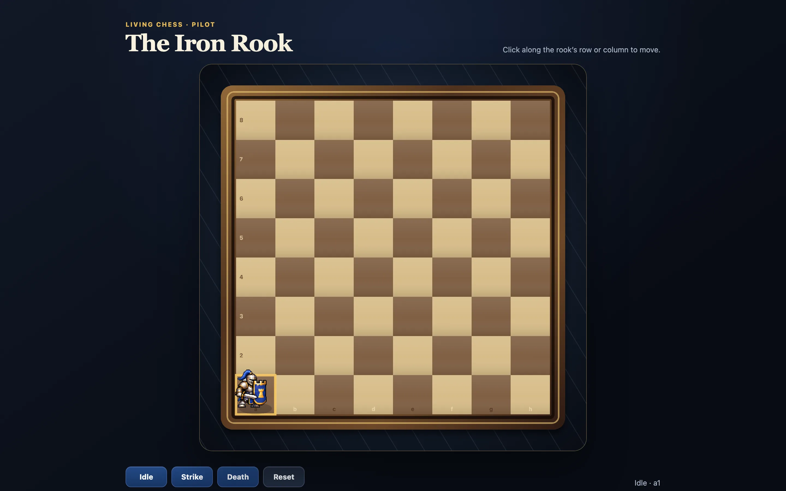

# Game-Making-Playground



## Living Chess rook pilot

A fixed-camera 2.5D browser prototype with an animated pixel-art rook, legal
horizontal and vertical movement, and Idle, Strike, Death, and Reset controls.
Press F for fullscreen.

Run it from the repository root:

```bash
python3 -m http.server 4173 --bind 127.0.0.1
```

Then open <http://127.0.0.1:4173/web-demo/>.

Run the automated tests with:

```bash
cd web-demo
npm test
```

`web-demo/package.json` declares no dependencies, but `tests/browser-smoke.test.mjs`
imports `playwright`, so that package (with a Chromium build) must be installed
for the browser test to run.

Design notes are in `docs/superpowers/specs/` and `docs/superpowers/plans/`.
